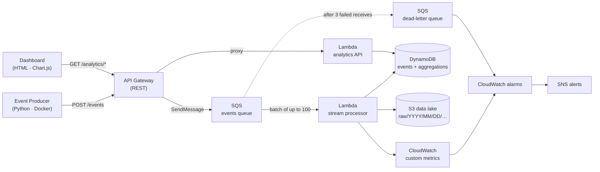

# HeyCloud

**Serverless real-time analytics for e-commerce event streams on AWS.**

[](https://github.com/Krish6115/HeyCloud/actions/workflows/ci.yml)


[](LICENSE)

HeyCloud simulates the traffic of an online store (product views, searches, carts, logins, purchases, payments), streams every event through a fully serverless AWS pipeline, and turns it into live metrics: revenue per minute, active users, top products and event trends, shown on a web dashboard.

Everything is defined as code: infrastructure in Terraform, services in Python, and build/test/deploy in GitHub Actions.

---

## Contents

- [Architecture](#architecture)
- [How an event flows](#how-an-event-flows)
- [Tech stack](#tech-stack)
- [Repository layout](#repository-layout)
- [Run it locally (no AWS needed)](#run-it-locally-no-aws-needed)
- [Deploy to AWS](#deploy-to-aws)
- [Analytics API](#analytics-api)
- [Data model](#data-model)
- [CI/CD](#cicd)
- [Monitoring & alerting](#monitoring--alerting)
- [Security](#security)
- [Design decisions](#design-decisions)
- [Make targets](#make-targets)

---

## Architecture



| Layer | What runs there |
|---|---|
| **Ingestion** | API Gateway `POST /events` writes the request body straight to SQS (no Lambda in the hot path). |
| **Processing** | The stream-processor Lambda validates, enriches and stores each batch. Bad records are counted and skipped without failing the batch. |
| **Hot storage** | DynamoDB: one table for raw events (7-day TTL), one for per-minute atomic counters. |
| **Cold storage** | S3 data lake, partitioned by date and event type, with lifecycle rules (Standard → IA → Glacier → expire). |
| **Serving** | The analytics-API Lambda answers dashboard queries from DynamoDB. |
| **Observability** | Custom CloudWatch metrics, a CloudWatch dashboard, alarms and SNS notifications. |

## How an event flows

1. The **producer** picks an event type using realistic weights (35% product views … 5% payments), builds it and POSTs it to `/events`.
2. **API Gateway** forwards it to the **SQS events queue** via a direct AWS service integration.
3. SQS triggers the **stream processor** with batches of up to 100 messages (5 s batching window).
4. For each batch the processor:
   - decodes and validates each record (schema + allowed event types),
   - writes the events to DynamoDB with `BatchWriteItem`,
   - archives each event to S3 as `raw/YYYY/MM/DD/<EVENT_TYPE>/<event_id>.json`,
   - increments per-minute counters (revenue, event counts, active users, product views/purchases),
   - publishes processing metrics to CloudWatch.
5. Messages that keep failing land in the **dead-letter queue**, which raises an alarm.
6. The **dashboard** polls `/analytics/summary` every 10 seconds and redraws its charts.

## Tech stack

| Concern | Choice |
|---|---|
| Event generation | Python 3.12, `requests`, Docker (multi-stage, non-root) |
| Ingestion | Amazon API Gateway (REST) → Amazon SQS |
| Compute | AWS Lambda (Python 3.12) |
| Storage | Amazon DynamoDB (on-demand, TTL), Amazon S3 |
| Monitoring | Amazon CloudWatch (metrics, dashboard, alarms), Amazon SNS |
| Container registry | Amazon ECR |
| Infrastructure as code | Terraform (modular, S3 remote state + DynamoDB locking) |
| CI/CD | GitHub Actions with AWS OIDC (no long-lived keys) |
| Dashboard | Static HTML/CSS/JS + Chart.js |
| Quality | pytest, ruff, bandit, moto |

## Repository layout

```
HeyCloud/
├── services/
│   ├── event-producer/        # Simulated e-commerce traffic (Dockerized)
│   │   ├── generators/        #   one generator per event type
│   │   └── models/            #   event schema
│   └── stream-processor/      # SQS-triggered Lambda
│       ├── processors/        #   transform/validate + aggregation
│       ├── storage/           #   DynamoDB and S3 writers
│       └── utils/             #   logging, metrics, retry with backoff
├── api/analytics/             # Analytics API Lambda (queries/ per endpoint)
├── dashboard/                 # Static dashboard (config.js holds the API URL)
├── infrastructure/
│   ├── terraform/             # Root module + modules/{s3,dynamodb,sqs,iam,lambda,api_gateway,monitoring,kinesis}
│   └── environments/          # dev.tfvars, prod.tfvars
├── scripts/                   # Bootstrap, deploy, packaging, seeding, end-to-end checks
├── tests/unit/                # pytest suites
├── .github/workflows/         # ci.yml, deploy-infra.yml, deploy-services.yml
├── docker-compose.yml         # Producer + dashboard for local use
└── Makefile
```

## Run it locally (no AWS needed)

**Requirements:** Python 3.12+ (Docker optional).

```bash
git clone https://github.com/Krish6115/HeyCloud.git
cd HeyCloud

pip install -r services/event-producer/requirements.txt \
            -r services/stream-processor/requirements.txt \
            -r api/analytics/requirements.txt \
            pytest ruff "moto[dynamodb,s3,cloudwatch]"
```

**Unit tests and lint**

```bash
python -m pytest tests/unit -v
ruff check services/ api/ tests/ scripts/
```

**Full pipeline end to end, against mocked AWS**

```bash
python scripts/local-e2e.py
```

This generates 200 real producer events, sends them through the stream processor as SQS batches into mocked DynamoDB and S3, then calls every analytics endpoint:

```
[1] generated 200 events
[2] stream processor stored 200 events, s3 objects=200
[3] /analytics/health        -> 200 {"status": "healthy", ...}
[3] /analytics/summary       -> 200 {"top_products": [...], "revenue": {...}, ...}
...
LOCAL END-TO-END PASSED
```

## Deploy to AWS

**Requirements:** AWS CLI v2 with credentials (`aws configure`), Terraform ≥ 1.5, Python 3.12, and Bash (Git Bash works on Windows).

### 1. One-time account setup

```bash
# Remote state bucket + lock table (bucket names are global: rename in
# scripts/bootstrap-terraform.sh and infrastructure/terraform/backend.tf if taken)
bash scripts/bootstrap-terraform.sh
```

Optionally set `alert_email` in `infrastructure/environments/dev.tfvars` to receive alarm emails.

### 2. Deploy

```bash
bash scripts/deploy.sh dev
```

The script runs in an order that also works on a brand-new account:

1. creates the S3 buckets,
2. packages both Lambdas and uploads them,
3. applies the rest of the infrastructure,
4. pushes the latest Lambda code and writes the API URL to `dashboard/config.js`.

### 3. Send traffic and open the dashboard

```bash
cp .env.example .env
# set API_GATEWAY_URL to: terraform -chdir=infrastructure/terraform output -raw api_gateway_url

docker compose up --build      # producer + dashboard on http://localhost:3000
```

Without Docker: `cd services/event-producer && python main.py`, and `make dashboard` for the UI. A different API can be pointed to with `http://localhost:3000/?api=<url>/analytics`.

### Tear down

```bash
bash scripts/destroy.sh dev
```

## Analytics API

Base URL: `<api_gateway_url>/analytics`. All endpoints are `GET`, return JSON with CORS enabled, and accept an optional `?date=YYYY-MM-DD` (default: today, UTC).

| Endpoint | Returns |
|---|---|
| `/health` | Service status |
| `/summary` | Everything below in one call (used by the dashboard) |
| `/top-products?limit=N` | Products ranked by views + purchases |
| `/revenue` | Total revenue and a per-minute revenue timeline |
| `/active-users` | Peak active users and a per-minute timeline |
| `/trends` | Event counts per type, plus a per-minute timeline |

Example:

```bash
curl "$API/analytics/revenue?date=2026-11-21"
# {"date": "2026-11-21", "total_revenue": 15013.55, "timeline": [{"time": "05:04", "revenue": 15013.55}]}
```

Ingestion endpoint: `POST <api_gateway_url>/events` with a single event as the JSON body. It returns `{"status": "accepted"}`.

## Data model

**Event (producer → pipeline)**

```json
{
  "event_id": "4b0e…",
  "event_type": "PURCHASE",
  "timestamp": "2026-11-21T05:04:12+00:00",
  "source": "event-producer-v1",
  "version": "1.0",
  "metadata": { "region": "ap-south-1", "platform": "mobile", "session_id": "…" },
  "user":     { "user_id": "usr_1234", "age_group": "26-35", "membership": "premium" },
  "payload":  { "order_id": "…", "total_amount": 249.99, "items": [ … ] }
}
```

Event types: `PRODUCT_VIEW`, `SEARCH`, `ADD_TO_CART`, `USER_LOGIN`, `PURCHASE`, `PAYMENT`.

**DynamoDB**

| Table | PK | SK | Notes |
|---|---|---|---|
| `heycloud-<env>-events` | `EVENT_TYPE#YYYY-MM-DD` | `timestamp#event_id` | GSIs `UserIndex`, `ProductIndex`; 7-day TTL |
| `heycloud-<env>-aggregations` | metric + date | `minute#HH:MM` | Atomic `ADD` counters; 7-day TTL |

**S3 data lake:** `raw/YYYY/MM/DD/<EVENT_TYPE>/<event_id>.json`. The date-first layout is ready for Athena or Glue partitions.

## CI/CD

| Workflow | Trigger | What it does |
|---|---|---|
| **CI Pipeline** (`ci.yml`) | Every push and PR to `main` | ruff lint, bandit security scan, pytest; `terraform fmt` + `validate`; Docker build of the producer |
| **Deploy Infrastructure** (`deploy-infra.yml`) | Push to `release/*` touching `infrastructure/`, or manual (dev/prod) | Creates S3 first, uploads Lambda zips, then `terraform plan` + `apply` |
| **Deploy Services** (`deploy-services.yml`) | Push to `release/*` touching `services/` or `api/`, or manual (dev/prod) | Repackages and updates both Lambdas, builds the producer image and pushes it to ECR |

The deploy workflows authenticate with **GitHub OIDC**, so no AWS keys are stored in GitHub. One-time setup:

```bash
bash scripts/bootstrap-github-oidc.sh Krish6115/HeyCloud
```

Then add the printed role ARN as the repository secret **`AWS_ROLE_ARN`**. That is the only secret required: bucket, function and repository names are read from Terraform state.

## Monitoring & alerting

- **Custom metrics** (namespace `heycloud/<env>`): events processed, events failed, processing duration, and counts per event type.
- **CloudWatch dashboard** for the pipeline.
- **Alarms → SNS:**
  - stream-processor Lambda errors
  - stream-processor duration approaching its timeout
  - messages in the dead-letter queue
  - API Gateway 5xx responses
- **Structured JSON logs** with a configurable log level and retention per environment.

## Security

- A separate IAM role for each Lambda, each scoped to the specific tables, bucket and queues it uses.
- API Gateway sends events to SQS through its own role, which is only allowed `sqs:SendMessage` on the events queue.
- S3 buckets are encrypted and versioned, with public access blocked; DynamoDB is encrypted at rest.
- API throttling through a usage plan; an API key is provisioned.
- Credentials are never committed:
  - Terraform uses the standard AWS credential chain.
  - CI/CD uses short-lived OIDC tokens.
  - `.env` is git-ignored.
- The producer container runs as a non-root user; ECR scans images on push.
- Every CI run includes a bandit scan.

## Design decisions

- **SQS instead of Kinesis.** The original design used Kinesis Data Streams (the module is still in `modules/kinesis`). The pipeline moved to SQS because:
  - it is pay-per-request with no shard-hour cost,
  - it has a built-in dead-letter queue,
  - it works on accounts without a Kinesis subscription.

  The stream processor accepts both record formats, so switching back means changing only the trigger.
- **No Lambda on ingestion.** API Gateway writes directly to SQS, which removes a cold start and per-request Lambda cost from the hot path.
- **Partial-failure tolerance.** One bad record is counted and skipped rather than failing the whole batch. Writes retry with exponential backoff.
- **Pre-aggregated counters.** The dashboard reads small per-minute counter items instead of scanning raw events, so queries stay fast and cheap as volume grows.
- **Hot and cold paths.** DynamoDB holds 7 days of data for live queries; S3 keeps the full history for batch analytics at a fraction of the cost.

## Make targets

```text
make test             Run all tests
make lint             ruff + terraform fmt check
make init|plan|apply  Terraform (dev)
make package-lambdas  Build Lambda zips (UPLOAD_BUCKET=<bucket> to upload)
make producer-build   Build the producer image
make docker-up        Producer + dashboard via docker compose
make dashboard        Serve the dashboard on :3000
make clean            Remove build artifacts
```

## License

[MIT](LICENSE) © Krish6115
